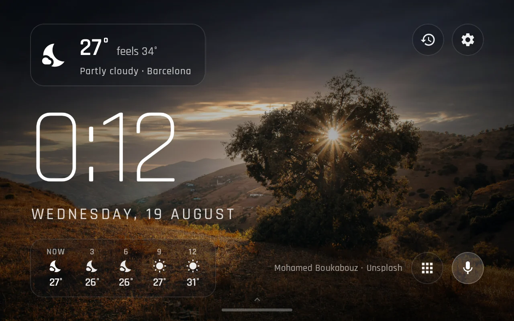
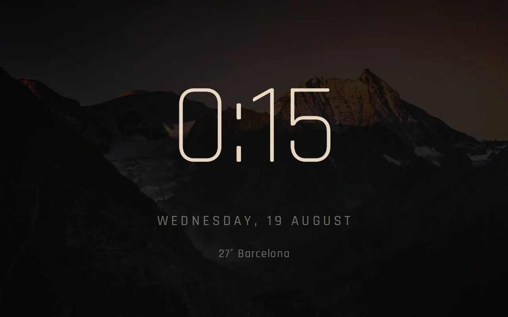
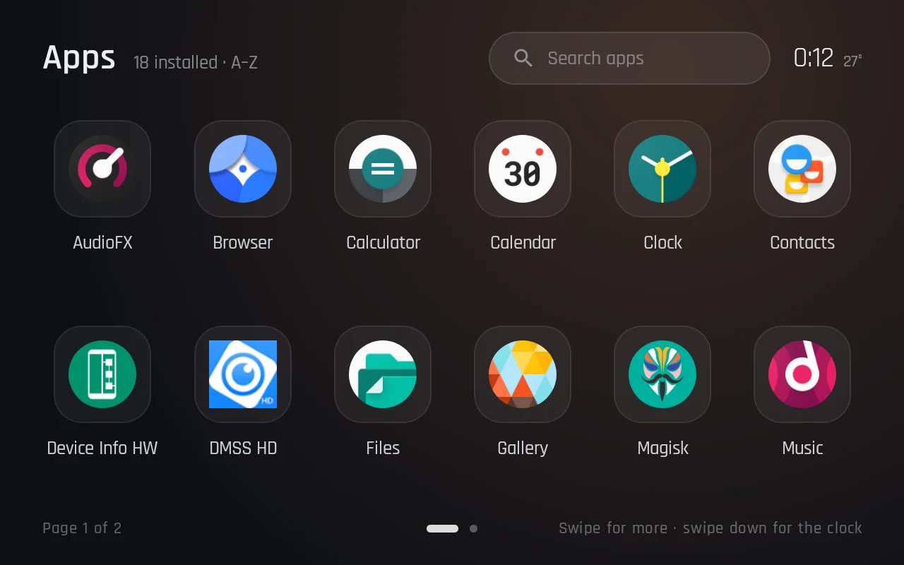
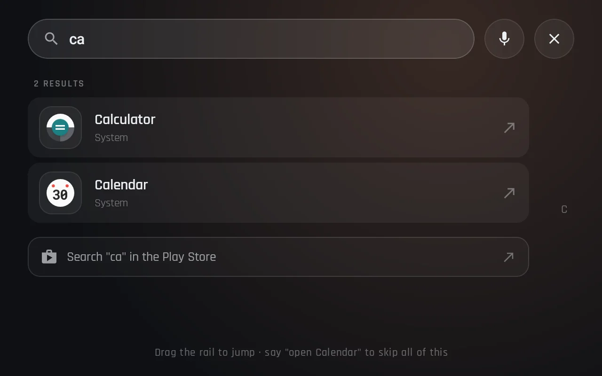
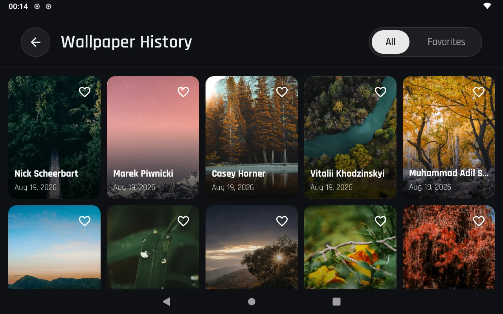
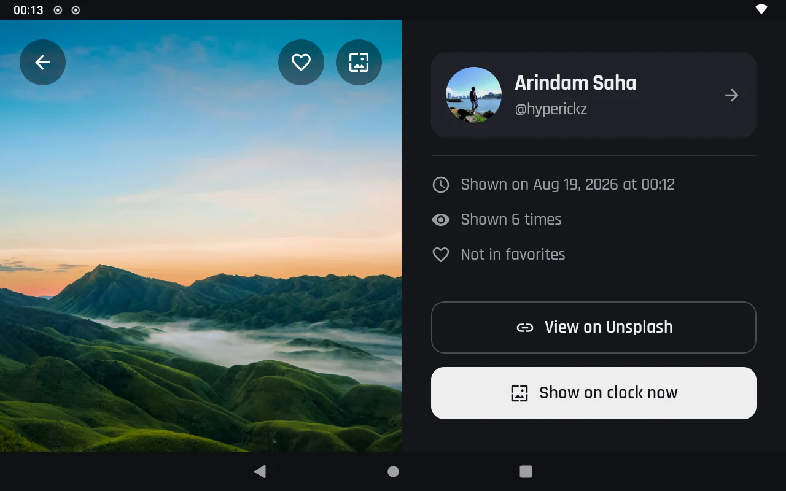
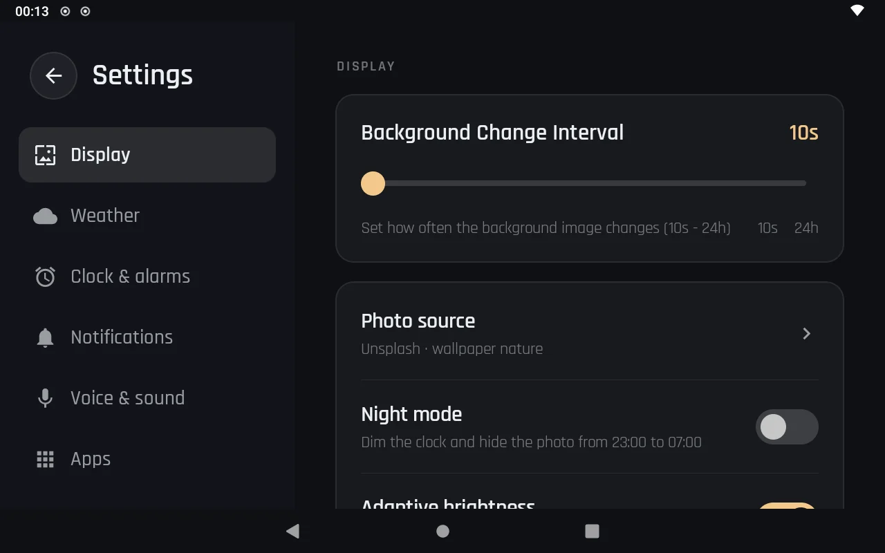
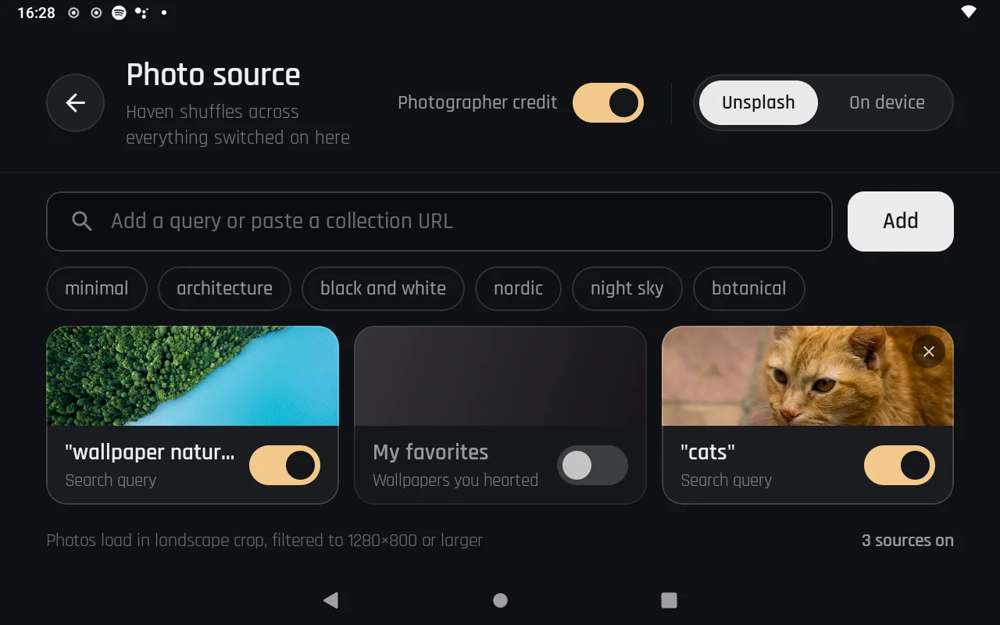
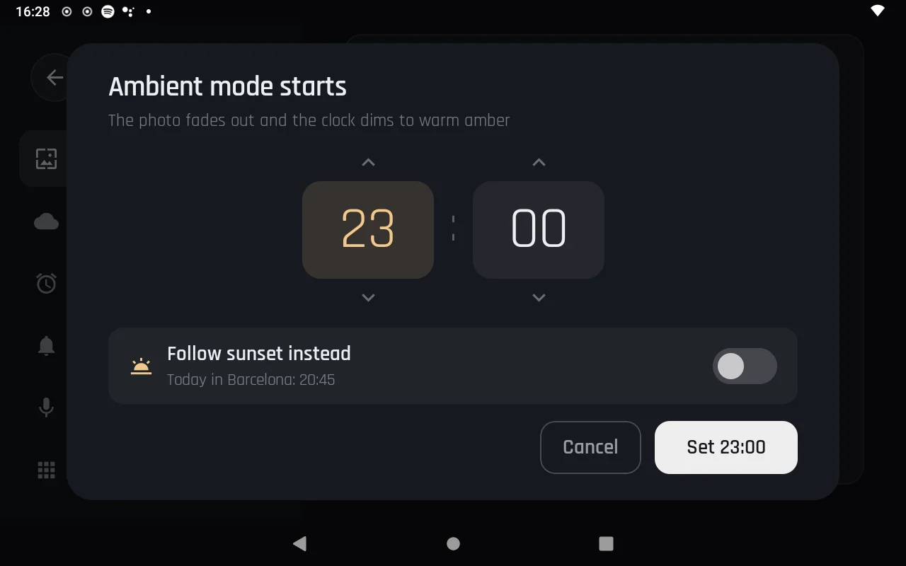

# Haven

[](https://github.com/iscle/Haven/actions/workflows/build.yml)
[](https://github.com/iscle/Haven/releases/latest)

A launcher for a wall-mounted smart display: a full-screen clock over a rotating Unsplash
wallpaper, with local weather, an app drawer, and only the notifications you actually want
visible in a shared room.

Built for an Echo Show 8 (1280 × 800, landscape) running LineageOS, but it is an ordinary
Android launcher — any always-on landscape display will do.



## Screens

| Ambient — 23:00 to 07:00 | App drawer |
| --- | --- |
|  |  |

| Drawer search | Wallpaper history |
| --- | --- |
|  |  |

| Photo details | Display settings |
| --- | --- |
|  |  |

| Photo sources | Ambient schedule |
| --- | --- |
|  |  |

## What it does

- **Clock** — 24-hour or 12-hour, optional seconds, tabular figures, readable across a room.
- **Weather** — current conditions, apparent temperature and a 12-hour forecast strip from
  [Open-Meteo](https://open-meteo.com), geocoded from a city name. No API key.
- **Wallpaper** — landscape photos on an interval you choose (10s – 24h), pre-loaded and
  cross-faded so the clock never flashes black. Photographer credit on screen, as the
  Unsplash terms require.
- **Photo sources** — mix Unsplash searches, whole collections (paste the URL), your
  favourites, and photos from the device; Haven shuffles across everything switched on.
- **History and favourites** — every wallpaper you have seen, kept in Room, with a favourites
  filter, a details pane, and *Show on clock now* to pin one back onto the clock.
- **App drawer** — every launchable app, alphabetical, twelve per page, reachable by swiping
  up from the clock, by the apps button, or by search with an A–Z rail.
- **Notifications** — an allow-list, so a clock in a kitchen shows the parcel and the message
  from Anna and nothing else. Content can be hidden to sender-only, and the whole stack
  disappears in ambient mode.
- **Ambient mode** — overnight the photo dims to a trace and the clock turns warm and dim.
  Pick the hours yourself, or let the window follow real sunset and sunrise for your city.
  One tap brings the day layout back for twenty seconds.

## Getting started

A signed APK is attached to every [release](https://github.com/iscle/Haven/releases/latest) —
download it and `adb install` it, or build it yourself.

Requirements: JDK 21, Android SDK 36, a device on Android 7.0 (API 24) or newer.

```bash
git clone https://github.com/iscle/Haven.git
cd Haven
./gradlew installDebug
```

Then on the device:

1. Press home and pick **Haven** as the launcher.
2. **Settings → Weather** — enter your city and save.
3. **Settings → Display** — set the wallpaper interval, night mode and photographer credit.

### Notification access

Reading notifications needs a grant that has no runtime permission dialog. Either use
**Settings → Notifications → Grant notification access** inside the app, or:

```bash
adb shell cmd notification allow_listener \
  com.github.iscle.haven/com.github.iscle.haven.data.notifications.HavenNotificationListenerService
```

Then choose which apps may appear on the clock in **Settings → Notifications**. Nothing is
allowed by default.

## Architecture

Single module, Compose UI, one activity per surface, MVVM over a small domain layer.

```
app/src/main/java/com/github/iscle/haven/
├── data/            Room, DataStore, Ktor clients, the notification listener
│   ├── local/       history + photo cache DAOs, preferences, installed apps
│   ├── notifications/  NotificationListenerService and its in-memory mirror
│   ├── remote/      Unsplash and Open-Meteo services
│   └── repository/  repository implementations
├── domain/          models, repository interfaces, use cases
├── presentation/    home · apps · history · settings · common components
└── ui/theme/        the Haven palette, Rajdhani typography, glass surfaces
```

| Concern | Choice |
| --- | --- |
| UI | Jetpack Compose, Material 3 |
| DI | Hilt |
| Networking | Ktor + kotlinx.serialization |
| Storage | Room (history, photo cache), DataStore (preferences) |
| Images | Coil |
| Logging | Timber |

Wallpapers come from Unsplash's public search endpoint and weather from Open-Meteo, so there
are no keys to configure.

## Releases

Pushing a `v*` tag builds a release APK, signs it with the key held in repository secrets and
publishes it with generated notes:

```bash
git tag v1.0.1
git push origin v1.0.1
```

Every push and pull request runs unit tests, lint and a debug build.

## Design

The interface is implemented from a Claude Design canvas — ten 1280 × 800 artboards covering
the clock, its ambient and polished states, the drawer that did not exist yet, history,
photo details and the settings panes. Screens follow the artboards closely: one dark surface,
glass only where content sits on a photo, and large touch targets throughout.

## Not there yet

- **Voice and media** — the artboards include a listening state and a now-playing card. The
  mic button currently opens the system assistant; there is no media session client.
- **Alarms** — Haven reports the alarm the system will ring next and hands editing to the
  clock app that owns it, rather than keeping a second schedule.
- **Calendar** — the next-event chip from the design needs calendar access and is not wired up.

## Credits

Photos by the Unsplash community · weather by [Open-Meteo](https://open-meteo.com) ·
[Rajdhani](https://fonts.google.com/specimen/Rajdhani) type under the SIL Open Font License.
